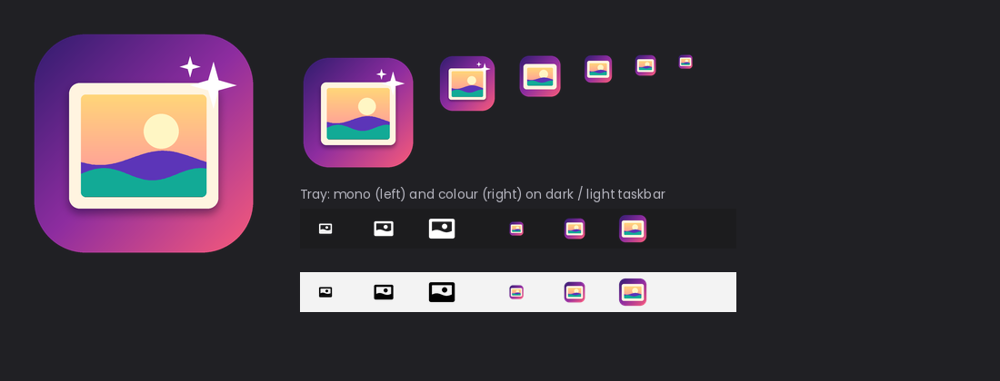

<p align="center">
  
</p>

<p align="center">
  
</p>

<h1 align="center">ArtWallpaper Manager v4.0.0</h1>

<p align="center">
  <strong>Transform your Windows and macOS desktop into a daily museum gallery.</strong><br>
  Curated masterpieces from The Metropolitan Museum of Art delivered automatically to your screen every day.
</p>

<p align="center">
  <a href="#-features"></a>
  <a href="#-features"></a>
  <a href="#-features"></a>
  <a href="https://github.com/Princeyyyy/art-wallpaper/releases"></a>
  <a href="LICENSE"></a>
</p>

---

## 🌟 What's New in v4.0.0

- 🍏 **Full macOS Support**: Native wallpaper setting via AppleScript System Events and macOS `LaunchAgents` auto-start `.plist` management.
- ⚡ **Dual Release Pipeline**: Automated manual GitHub Actions workflow building both **Windows MSI** (`packageMsi`) and **macOS DMG** (`packageDmg`) releases.
- 🧭 **Guided 4-Step Onboarding**: A complete interactive setup wizard (Welcome → Schedule presets → System integration → Live curation and desktop reveal).
- 🚀 **Performance & Battery Engine**:
  - Asynchronous non-blocking image decoding on `Dispatchers.IO`.
  - In-memory `ArtworkBitmapCache` for instantaneous 60/120fps window navigation with zero frame drops.
  - Off-heap native memory reclaim via automatic `BufferedImage.flush()` cleanup.
  - Battery-friendly timers sleeping precisely until the next rotation window without busy CPU polling.
  - In-memory Met Museum department ID caching to bypass 10,000+ item redundant network downloads.
- 🎯 **Synchronized System Tray / Menu Bar**:
  - Dynamic Pause/Resume menu item that reflects background engine status in real time.
  - Active artwork tooltip and header displaying the currently loaded masterpiece title.
  - Direct "Next Wallpaper" trigger from the taskbar notification area.
  - Strict adherence to desktop notification preferences.

---

## 🎨 Asset Showcase

<p align="center">
  
</p>

ArtWallpaper includes a complete professional multi-platform asset pack:
- **Application Icons** (`src/main/resources/icons/`): Multi-resolution Windows executable icons (`icon.ico` from 16x16 to 256x256), master 1024x1024 artwork, and native Apple Icon Image (`icon.icns`).
- **Windows Start & Store Tiles** (`src/main/resources/icons/tiles/`): Full suite of Windows Start Menu and Microsoft Store tiles (`Square30x30Logo` up to `Square310x310Logo`, `StoreLogo`, and `Wide310x150Logo`).
- **System Tray Graphics** (`src/main/resources/tray/`): Pixel-perfect multi-DPI color icons (`tray-16` to `tray-64`, `tray.ico`) and native high-contrast monochrome variants (`tray-mono-white` and `tray-mono-black`) for dark and light taskbars/menu bars.
- **Installer Artwork** (`src/main/resources/installer/`): WiX MSI banners (`wix-banner-493x58.bmp`), dialog backgrounds (`wix-dialog-493x312.bmp`), and wizard sidebars (`wizard-large-164x314.bmp`).
- **Branding** (`src/main/resources/branding/`): Vector master logo (`logo.svg`), high-res README banner (`1600x420`), and GitHub social preview card (`1280x640`).

---

## ✨ Features

- 🏛️ **Museum-Grade Curation**: Draws from the public domain collection of The Metropolitan Museum of Art (400,000+ open-access artworks).
- 🌅 **Automatic Daily Rotation**: Configurable refresh time (default 07:00 AM) that persists across reboots.
- 🖼️ **Full-Bleed Gallery UI**: Editorial dark aesthetic with subtle scrims, title/artist typography, and smooth crossfades.
- ⚡ **Native System Tray & Menu Bar**: Runs discreetly in the Windows taskbar or macOS menu bar with dynamic pause/resume, instant refresh, and notification support.
- 💾 **Smart Offline Fallback**: High-resolution artworks and JSON metadata stay saved locally in your personal gallery; if the internet is down, ArtWallpaper rotates through saved gems.
- 🧹 **Automatic Storage Pruning**: Keeps up to 100 recent artworks, automatically cleaning up orphaned files and cache artifacts.
- 🚀 **Cross-Platform Auto-Start**:
  - *Windows*: Configured directly in `HKCU\Software\Microsoft\Windows\CurrentVersion\Run`.
  - *macOS*: Configured in `~/Library/LaunchAgents/com.prince.artwallpaper.plist`.
- 🛡️ **Crash-Resilient Settings**: Dual-layer settings storage with automatic `.json.bak` backup restoration.

---

## 🚀 Getting Started

### Windows Installation via MSI
1. Download `ArtWallpaper-4.0.0-Windows.msi` from [Releases](https://github.com/Princeyyyy/art-wallpaper/releases).
2. Run the installer. ArtWallpaper installs into:
   ```
   C:\Users\%USERNAME%\AppData\Local\Art Wallpaper
   ```
3. Launch ArtWallpaper. The guided onboarding wizard will help you configure schedule, auto-start, and set your first masterpiece!

### macOS Installation via DMG
1. Download `ArtWallpaper-4.0.0-macOS.dmg` from [Releases](https://github.com/Princeyyyy/art-wallpaper/releases).
2. Open the `.dmg` and drag **Art Wallpaper** into your `/Applications` folder.
3. Launch the app from Spotlight or Applications.

### Command-Line Arguments
ArtWallpaper supports several flags for automated environments and troubleshooting:
```bash
# Launch minimized directly to system tray / menu bar
ArtWallpaper --minimized --autostart

# Reset and purge all local caches, history, and settings
ArtWallpaper --clear-data
```

---

## 📁 Data Storage

All user data is stored safely in `%USERPROFILE%\.artwallpaper\` (Windows) or `~/.artwallpaper/` (macOS):

| Path | Purpose |
|---|---|
| `artworks/` | High-resolution wallpapers (`{id}.jpg`) for active use and offline rotation |
| `metadata/` | Artwork information (`{id}.json` with title, artist, year, medium) |
| `settings.json` | Active user preferences (update time, auto-start, notifications) |
| `settings.json.bak` | Redundant backup copy automatically restored if primary file is corrupted |
| `history.json` | Record of visited artwork IDs to prevent duplicate wallpapers |
| `logs/` | Daily rolling diagnostic logs |
| `app.lock` | Single-instance lock storing active process ID |

---

## 🎮 System Tray / Menu Bar Controls

Right-click the ArtWallpaper icon in your Windows notification area or click the macOS menu bar icon:
- **Art Wallpaper**: Displays the currently active artwork title.
- **Open Art Wallpaper**: Brings the main gallery window to the foreground.
- **Next Wallpaper**: Fetches and applies a new masterpiece immediately.
- **Pause / Resume Auto-Update**: Dynamically pauses or resumes scheduled background rotation.
- **Exit**: Performs safe coroutine cleanup, releases locks, and closes the application.

---

## 🧪 Testing & CI/CD Pipeline

The project features a comprehensive multi-platform test suite:
- **Unit Tests**: `HistoryManagerTest`, `SettingsTest`, `RetryPolicyTest`, `ArtworkStorageManagerTest`, `WallpaperManagerTest`, `ServiceControllerTest`.
- **Integration Tests**: `UserFlowTest` (real file I/O tests covering onboarding, deduplication, storage, roundtrips, offline fallback, orphan pruning).
- **Stress & Concurrency Tests**: `LifecycleAndStressTest` (20-thread PID lock race, stale lock recovery, 200 concurrent history writes, service deadlock stress, wallpaper Mutex verification).
- **Resilience Tests**: `CorruptDataResilienceTest` (malformed JSON recovery, corrupt metadata skipping, empty file self-healing).
- **Platform Tests**: `PlatformServicesTest` (cross-platform OS detection, Windows/Mac service dispatch, macOS LaunchAgent `.plist` generator, AppleScript syntax validation).
- **Asset Integrity Tests**: `AssetIntegrityTest` (validates all 60+ icons, tray graphics, installer bitmaps, and brand vectors).
- **GitHub Actions Workflows**:
  - `ci.yml`: Runs `compileKotlin` and `test` matrix across `windows-latest` and `macos-latest`.
  - `release.yml`: Manually triggered workflow (`workflow_dispatch`) that runs tests, builds both Windows MSI and macOS DMG installers, and publishes a GitHub Release with both binaries attached.

---

## 📜 License

Licensed under [Creative Commons Attribution-NonCommercial 4.0 International (CC BY-NC 4.0)](http://creativecommons.org/licenses/by-nc/4.0/).
Artworks delivered by the application belong to the public domain collections of The Metropolitan Museum of Art.
